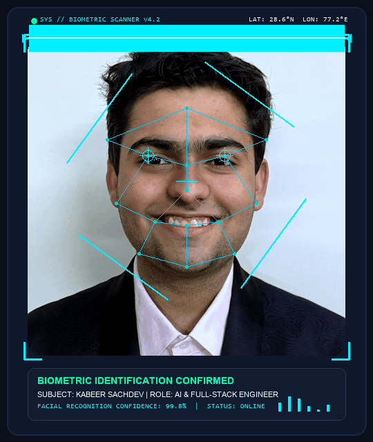

# ⚡ KABEER SACHDEV ⚡
### 🚀 AI Systems Engineer & Full-Stack Architect | Building Autonomous Multi-Agent Systems

  
  
  
  

---

## 🧬 BIOMETRIC IDENTITY TELEMETRY

<table border="0" align="center" width="100%">
  <tr>
    <td width="48%" align="center" valign="middle">
      
    </td>
    <td width="52%" valign="top">
      

        <h3 style="color: #00F0FF; margin-top: 0;">🛰️ [ SYSTEM TELEMETRY // PROFILE MATRIX ]</h3>
        <ul>
          <li><b>Identity:</b> Kabeer Sachdev</li>
          <li><b>Specialization:</b> Agentic AI Systems, Full-Stack Architecture & Operations Research</li>
          <li><b>Education:</b> B.Tech in Computer Science & Engineering (2022 – 2026)</li>
          <li><b>Primary Focus:</b> Multi-Agent LLM Graph Workflows, Predictive Regression, Discrete Mathematical Optimization</li>
          <li><b>Location:</b> New Delhi, India 🇮🇳</li>
          <li><b>System Status:</b> 🟢 ONLINE & OPEN FOR HIGH-IMPACT ROLES</li>
          <li><b>Flagship Innovation:</b> <a href="https://github.com/Kabeer-Sachdev/CareCoord-AI-"><b>CareCoord AI</b></a> (Stateful Multi-Agent Clinical Workflow System)</li>
        </ul>
        

        

          <i>"Bridging the chasm between probabilistic Generative AI and mission-critical enterprise engineering through deterministic state machines, exact mathematical solvers, and human-in-the-loop safety governance."</i>
        

      

    </td>
  </tr>
</table>

---

## 🌟 FLAGSHIP SYSTEM: [CareCoord AI](https://github.com/Kabeer-Sachdev/CareCoord-AI-)

> **A Multi-Agent AI System for Intelligent Hospital Workflow, Resource Coordination, and Real-Time Operational Management.**

* 🤖 **Stateful Multi-Agent DAG**: 9 specialized agent nodes (Doctor, Patient, Bed, Emergency, Policy, Prediction, Optimization) orchestrating hospital operations in **$20.3\text{ ms}$** mean latency with **$97.3\%$ workflow completion**.
* ⚡ **Google OR-Tools Discrete Optimization**: Solves Mixed Integer Programming (MIP) appointment & shift scheduling problems, reducing average patient waiting time by **$63.64\%$** and eliminating physician workload imbalance ($\sigma = 0.00$) with a **mathematical guarantee of zero collisions**.
* 📈 **Predictive Time-Series Demand Forecasting**: Ensemble regression (Gradient Boosting & Random Forest) beating 7-day moving average baselines by **$32.9\%\text{--}49.3\%$ lower MAE** ($R^2$ up to **$0.973$**).
* 🛡️ **Human-in-the-Loop (HITL) Safety Gate**: Zero autonomous mutations to critical clinical tables—all booking and bed operations halt in `PENDING_APPROVAL` for authorized staff sign-off.
* 🏥 **Standard Interoperability**: Direct HL7 FHIR Release 4 resource mapping and 3 Anthropic Model Context Protocol (MCP v2.3.0) servers with 13 standardized tools.

---

## 🛠️ TECH ARSENAL & TOOLKIT

### 💻 Core Programming Languages

  
  
  
  
  
  
  

### 🧠 Artificial Intelligence, Agents & Operations Research

  
  
  
  
  
  
  
  
  

### ⚙️ Full-Stack & Backend Engineering

  
  
  
  
  
  
  
  
  

### 🗄️ Databases, Cloud & Developer Tooling

  
  
  
  
  
  
  

---

## 📊 GITHUB LIVE TELEMETRY & CODING STREAK

  
  

  

---

## 📬 CONNECT & COLLABORATE

Looking for an **AI Engineer**, **Full-Stack Systems Developer**, or **Autonomous Agent Architect**? Let's connect!

  
  &nbsp;&nbsp;
  
  &nbsp;&nbsp;
  

  ⚡ Designed & Engineered with precision by <b>Kabeer Sachdev</b>. Powered by Agentic Intelligence.

