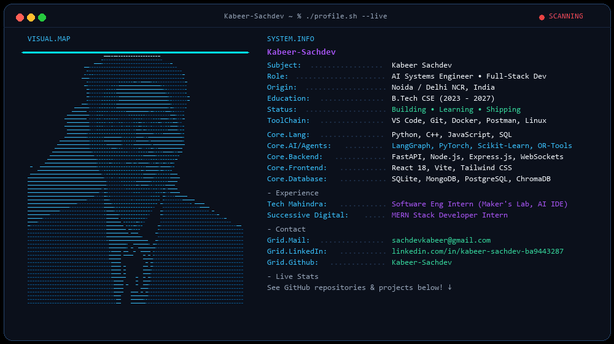

# ⚡ KABEER SACHDEV ⚡
### 🚀 AI Systems Engineer & Full-Stack Architect | Autonomous Multi-Agent Systems

  
  
  
  

---

### 🛰️ SYSTEM INTERFACE // LIVE VISUAL MAP & TELEMETRY

  

---

## 💼 PROFESSIONAL WORK EXPERIENCE

### 🏢 **Tech Mahindra – Maker’s Lab**
**Software Engineering Intern** | *June 2026 – August 2026* | *Noida, India*
* **AI-Powered Brownfield Development Environment**: Engineered a browser-based IDE featuring project understanding, intelligent codebase search, impact analysis, and AI-assisted code refactoring using **Python, FastAPI, JavaScript, Monaco Editor, xterm.js, and WebSockets**.
* **Enterprise AI Code Migration Agent**: Developed an autonomous code migration pipeline supporting **10+ programming languages** and **15+ application frameworks**, achieving full 3-tier application modernization with complete architecture preservation and dependency compatibility analysis.
* **Provider-Agnostic LLM Gateway**: Implemented a resilient, vendor-independent LLM orchestration layer integrating **7+ AI providers** (*Ollama, Gemini, Groq, OpenRouter, OpenAI, Azure OpenAI, Local APIs*) with dynamic zero-downtime provider switching via configuration.
* **Governed Migration Lifecycle**: Designed a secure 6-phase migration workflow with automated verification checks, human-in-the-loop approvals, instant rollbacks, execution audit logs, downloadable compliance reports, and lazy loading for large monorepos.

---

### 🚀 **Successive Digital**
**MERN Stack Developer Intern** | *June 2025 – July 2025*
* **Full-Stack Application Deployment**: Engineered and deployed **3+ production-ready MERN web applications** using **React, Node.js, Express.js, and MongoDB**.
* **API Performance Optimization**: Profiling and restructured **10+ REST API endpoints**, reducing response latency by **30%** through indexing, query optimization, and payload caching.
* **Agile Collaboration**: Partnered within a 4-member agile engineering team using Git, adhering to clean architecture patterns, code reviews, and structured sprint cycles.

---

## 🌟 FEATURED FLAGSHIP PROJECTS

<table border="0" width="100%">
  <tr>
    <td width="33%" valign="top">
      

        <h3>🏥 <a href="https://github.com/Kabeer-Sachdev/CareCoord-AI-">CareCoord AI</a></h3>
        
<b>Agentic Healthcare Workflow System</b>

        
A multi-agent AI system for intelligent hospital workflow, resource coordination, and real-time operational management.

        <ul>
          <li><b>LangGraph Multi-Agent DAG:</b> 9 specialized agents (Doctor, Bed, Emergency, Triage, Policy RAG) with 97.3% completion.</li>
          <li><b>Google OR-Tools MIP:</b> Mixed Integer Programming scheduling cutting patient wait times by <b>63.64%</b> with 0% collisions.</li>
          <li><b>Predictive ML:</b> Time-series regression (Gradient Boosting) delivering <b>32.9%–49.3% lower MAE</b> ($R^2 \le 0.973$).</li>
          <li><b>Standards:</b> HL7 FHIR R4 & Anthropic Model Context Protocol (MCP v2.3.0).</li>
        </ul>
        
<code>LangGraph</code> <code>OR-Tools</code> <code>FastAPI</code> <code>React 18</code> <code>ChromaDB</code>

      

    </td>
    <td width="33%" valign="top">
      

        <h3>🧠 MindEase AI</h3>
        
<b>Intelligent Mental Health Assistant</b>

        
An AI-powered mental health support agent using transformer-based NLP for deep sentiment analysis and empathetic dialogue.

        <ul>
          <li><b>BERT & Transformers:</b> Fine-tuned Hugging Face transformer models for multi-class emotional state detection.</li>
          <li><b>Dataset Classification:</b> Processed and classified <b>1,000+ clinical and support text samples</b>.</li>
          <li><b>Inference Optimization:</b> Streamlined model pipeline, cutting token latency by <b>35%</b> for real-time empathetic interactions.</li>
        </ul>
        
<code>Python</code> <code>PyTorch</code> <code>BERT</code> <code>HuggingFace</code> <code>Flask</code>

      

    </td>
    <td width="33%" valign="top">
      

        <h3>💼 Jobber AI</h3>
        
<b>AI Autonomous Recruitment Agent</b>

        
An intelligent end-to-end recruitment automation agent streamlining job discovery, filtering, and application submissions.

        <ul>
          <li><b>Browser Automation:</b> Headless automation via Puppeteer executing <b>100+ automated job applications</b> across 5+ portals.</li>
          <li><b>Intelligent Matching:</b> AI-driven matching and scoring algorithm filtering and ranking <b>150+ opportunities</b>.</li>
          <li><b>Form Synthesis:</b> Dynamic profile parsing and automated form filling reducing application overhead.</li>
        </ul>
        
<code>Node.js</code> <code>React</code> <code>Express</code> <code>MongoDB</code> <code>Puppeteer</code>

      

    </td>
  </tr>
</table>

---

## 🛠️ TECH ARSENAL & TOOLKIT

### 💻 Core Programming Languages

  
  
  
  
  
  
  

### 🧠 Artificial Intelligence, Agents & Operations Research

  
  
  
  
  
  
  
  
  

### ⚙️ Full-Stack & System Architecture

  
  
  
  
  
  
  
  
  

### 🗄️ Databases, DevOps & Tooling

  
  
  
  
  
  
  
  

---

## 🎓 EDUCATION

* **Bachelor of Technology (B.Tech) — Computer Science & Engineering (CSE)**
  * **Duration:** *2023 – 2027*
  * **Core Focus:** Artificial Intelligence, Multi-Agent Systems, Data Structures & Algorithms, Distributed Backend Architecture

---

## 📊 GITHUB LIVE TELEMETRY & CONTRIBUTION MATRIX

### 📈 Activity & Contribution Graph

  

### ⚡ Developer Velocity & Coding Streak

  
  

### 💻 Most Used Languages

  

---

## 📬 CONNECT & COLLABORATE

Looking for an **AI Systems Engineer**, **Full-Stack Developer**, or **Autonomous Agent Architect**? Let's talk!

  
  &nbsp;&nbsp;
  
  &nbsp;&nbsp;
  

  ⚡ Engineered with precision by <b>Kabeer Sachdev</b>. Powered by Agentic Intelligence.

